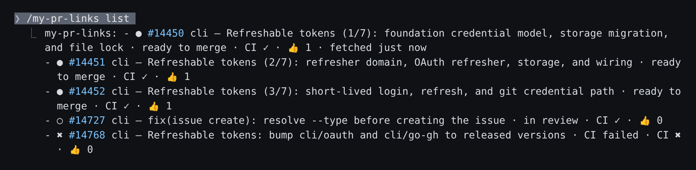

# my-pr-links

A Claude Code mod that shows the pull requests of your session in a band above the prompt, with their state, CI, approvals and the next action.


## What you get

- **Session tracking.** The band lists the PRs that the session and its subagents created or updated. Add any other PR with `/my-pr-links add <url>`.
- **GitHub and GitLab.** GitHub PRs come through `gh`, GitLab merge requests through `glab`.
- **Groups.** PRs group by ticket key (from the branch, the title or the description) or by a shared source branch. An optional title command puts a title next to each key.
- **Next action.** Each group header says what to do next: `fix CI #23859`, `you merge #23885`, `undraft #23870`, `review #14727`. Groups that need you sort first.
- **State, CI and approvals** on every row. Hover a row for the full title.
- **Click to open.** Click a ref to open the PR, or the CI cell to open the pipeline (GitLab) or check (GitHub) page.
- **Change toasts.** A toast says when a PR merges, closes, fails CI or becomes ready to merge.
- **Folding.** Past 12 PRs, finished groups shrink to their header line.
- **Stacked PRs.** A PR that targets the branch of another open PR shows `⧗ after <ref>` and sorts after its base.
- **Several `gh` accounts.** Each PR is fetched as an account that can read it.

## Screenshots

With no ticket key in any PR, the band is a plain list with no headers. Here three PRs form a stack:


`/my-pr-links list` prints every PR of the last fetch with its full title and a link:



The screenshots show public PRs of [apache/kafka](https://github.com/apache/kafka) and [cli/cli](https://github.com/cli/cli), added with `/my-pr-links add`.

## Requirements

- Claude Code 2.1.287 or later (tested on 2.1.306).
- `gh` for GitHub, `glab` for GitLab, installed and logged in (`gh auth login`, `glab auth login`). Install only the one you use.

## Install

In one step (Claude Code 2.1.292 or later):

```sh
claude plugin install my-pr-links --marketplace joboyx/my-pr-links
```

Or in two steps, inside Claude Code:

```text
/plugin marketplace add joboyx/my-pr-links
/plugin install my-pr-links@my-pr-links
```

From a local clone, for one session:

```sh
claude --plugin-dir path/to/my-pr-links
```

For a whole team, commit this to the repo's `.claude/settings.json`. Everyone who opens the repo and trusts the folder gets the band, with no install step:

```json
{
  "extraKnownMarketplaces": {
    "my-pr-links": { "source": { "source": "github", "repo": "joboyx/my-pr-links" } }
  },
  "enabledPlugins": { "my-pr-links@my-pr-links": true }
}
```

Third-party marketplaces do not auto-update by default. Turn it on in `/plugin` → Marketplaces, or run `claude plugin update my-pr-links@my-pr-links`.

## Usage

| Command                      | Effect                                                   |
| ---------------------------- | -------------------------------------------------------- |
| `/my-pr-links`               | Hide the band, or show it again                          |
| `/my-pr-links list`          | Print every PR of the last fetch, with links             |
| `/my-pr-links refresh`       | Fetch now                                                |
| `/my-pr-links open <ref>`    | Open one PR: `42`, `!42`, `#88`                          |
| `/my-pr-links open <ref> ci` | Open the CI page of one PR: the pipeline or a check      |
| `/my-pr-links add <url>`     | Add a PR or MR that the session did not create or update |

The band fetches again when a tool call creates or updates a PR. It also refreshes every minute while a PR has CI running or is ready to merge, and every 3 minutes otherwise.

A toast says when a PR merges, closes, fails CI or becomes ready to merge, once per change. A new CI run can announce its result again.

Past 12 PRs, a finished group (every PR merged or closed) shows only its header line. A plain list with no header keeps every row. `list` always prints every PR.

`open <ref> ci` and the CI cell open the head pipeline of a GitLab merge request. For a GitHub PR they open the first failed check, else the first running check, else the first check with a page.

### Row states and next actions

| Icon | State          |
| ---- | -------------- |
| `✖`  | CI failed      |
| `●`  | ready to merge |
| `◐`  | CI running     |
| `◌`  | draft          |
| `○`  | in review      |
| `✔`  | merged         |
| `⊘`  | closed         |

The group header names one next action. A PR with failed CI wins (`fix CI <ref>`), then a PR that is ready to merge (`you merge <ref>`). Otherwise the first open PR decides: `CI running <ref>`, `undraft <ref>` or `review <ref>`. With no open PR, the header says `all merged`. Groups with failed CI sort first, then groups ready to merge.

## Grouping

A ticket key matches `[A-Z][A-Z0-9]{1,9}-\d+`. The first rule that matches gives the group:

| # | Source               | Matches                                                       | Does not match            |
| - | -------------------- | ------------------------------------------------------------- | ------------------------- |
| 1 | Branch               | key at the start of a path segment: `feature/ABC-123-retry`, `ABC-123-ui` | `feature/fix-ABC-123` |
| 2 | Commit-style scope   | `feat(ABC-123): …`, `fix(api,ABC-123): …`                     |                           |
| 3 | Title prefix         | the title, or its text after the commit type, starts with `KEY: ` or `[KEY] `: `ABC-123: …`, `[ABC-123] …`, `feat: ABC-123: …` | `ABC-123 fix retry` |
| 4 | Description line     | `Refs: ABC-123`, `Closes ABC-1, ABC-2`, `Closes #12, ABC-2`; also `Ref`, `Fixes`, `Resolves`, `Issue`, `Ticket`, `Task`, `Jira` as whole words. The first list item that is a whole key wins; a trailing `.` is allowed | `Fixes ABC-123 later`, `TaskABC-12` |
| 5 | Shared source branch | no key, and 2 or more PRs share a branch that is not `main`, `master`, `develop`, `dev`, `trunk`, `staging` or `production` | |

Keys in running text never count. Standard codes never count in any rule: keys that start with `CVE`, `UTF`, `SHA`, `ISO`, `HTTP`, `RFC`, `TLS`, `MD` or `GHSA` (`fix/CVE-2024-1234`, `UTF-8`, `ISO-8601`). Lowercase keys such as `eng-123` are not supported.

Groups show first. PRs with no key go under `other` when a group exists. With no group, the band is a plain list with no header.

A row shows the PR title without a draft marker (`Draft:`, `WIP:`, `[Draft]`, `[WIP]`, `(Draft)`), the commit type and the group's own key. Only a lowercase word is a commit type, so `Release: v1.2` stays as written. An area scope stays as `scope: desc`. When nothing is left, the row shows the full title. Rows are cut at 50 characters with `…`.

## Stacked PRs

A PR whose target branch is the source branch of another open PR in the same repo stacks on that PR. Its row shows `⧗ after <ref>`. In the same group it sorts right after its base. When the base merges, the mark goes and the PR keeps its place.

## Several GitHub accounts

When `gh` is logged in to more than one github.com account, the mod fetches each PR as an account that can read it:

- Once per fetch, it lists the accounts with `gh auth status --json hosts --hostname github.com`.
- It tries the account named like the repo owner first, then the active account, then the others.
- For an account that is not active, it reads the token with `gh auth token --hostname github.com --user <login>` and gives it to `gh` in `GH_TOKEN`. It keeps the token for that fetch only.

## Title command

A group header shows the key. To also show a title, name one executable in one of these ways. The option wins when both are set.

- The `task_title_cmd` option: `/plugin` → my-pr-links → Configure, or `claude plugin configure my-pr-links@my-pr-links --values-stdin` (see below).
- The `MY_PR_LINKS_TASK_TITLE_CMD` environment variable, set before you start `claude`. Use it for a `--plugin-dir` session: the option reaches only an installed copy.

The contract:

- The mod runs `<cmd> <KEY>` with no shell, once per ticket key per fetch, with a 2 s timeout.
- The command gets Claude Code's environment.
- Exit 0 and a non-empty first stdout line: that line is the title. Any other result: no title.
- The mod does not call it for shared-branch groups.

Example for Jira Cloud:

```bash
#!/usr/bin/env bash
# jira-title: print the summary of one Jira issue.
set -euo pipefail
curl -fsS -u "$JIRA_EMAIL:$JIRA_API_TOKEN" \
  "$JIRA_BASE_URL/rest/api/3/issue/$1?fields=summary" | jq -er .fields.summary
```

```sh
chmod +x ~/bin/jira-title
echo "{\"task_title_cmd\": \"$HOME/bin/jira-title\"}" | claude plugin configure my-pr-links@my-pr-links --values-stdin
# or, for the environment variable, before you start claude:
export MY_PR_LINKS_TASK_TITLE_CMD=~/bin/jira-title
```

## Opening links

Links open with `$BROWSER` when it is set. The mod takes the first entry of a `:`-separated list, splits it on spaces, and puts the URL in place of `%s`, or last. It does not wait for the browser to exit.

When `$BROWSER` is unset or cannot start, the mod uses `explorer.exe` on WSL, `open` on macOS and `xdg-open` on other systems. When no opener works, or `$BROWSER` exits with an error, the mod says why.

Point `$BROWSER` at a launcher that hands the URL off and exits (`xdg-open`, `wslview`, `open`). A browser that the mod starts itself stops when the mod reloads.

## What it runs

The mod runs these commands as you, with no shell:

| Command             | When                                                             |
| ------------------- | ---------------------------------------------------------------- |
| `gh`                | Fetch a GitHub PR (`gh pr view`), read logins (`gh auth status`, `gh auth token`) |
| `glab`              | Fetch a GitLab merge request and its approvals (`glab api`)      |
| The title command   | Once per ticket key per fetch, when you set one                  |
| `$BROWSER`, `uname`, `explorer.exe`, `open` or `xdg-open` | When you click a ref or a CI cell, or run `/my-pr-links open` |

## Limits

- Rule 5 compares branch names only. GitHub web-editor branches such as `patch-1` in different repos can form one shared-branch group.
- Lowercase ticket keys such as `eng-123` are not supported.
- The band shows only PRs that a tool call in this session created or updated, or that you added with `add`. It does not search your accounts for other PRs.

## Development

See [AGENTS.md](AGENTS.md).

## License

MIT. See [LICENSE](LICENSE).
